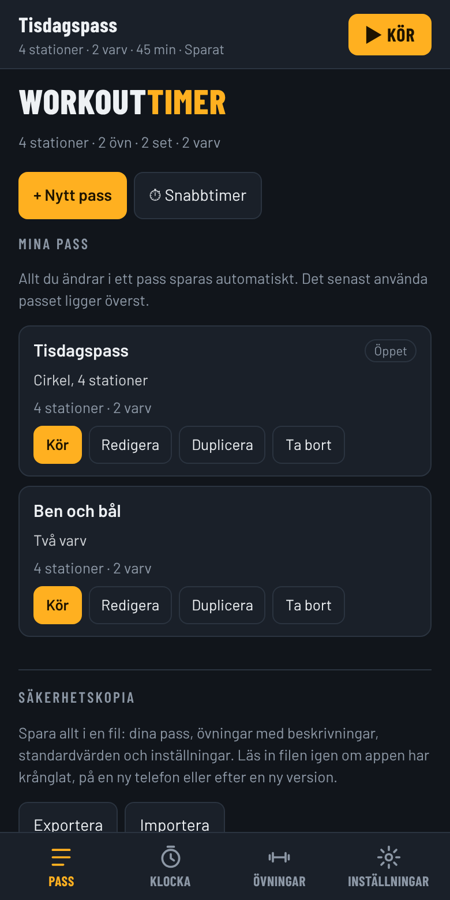
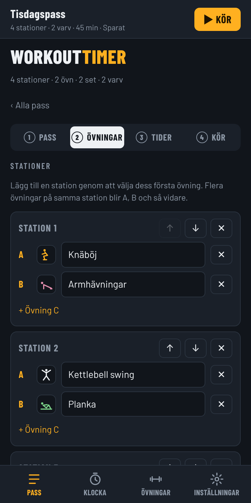
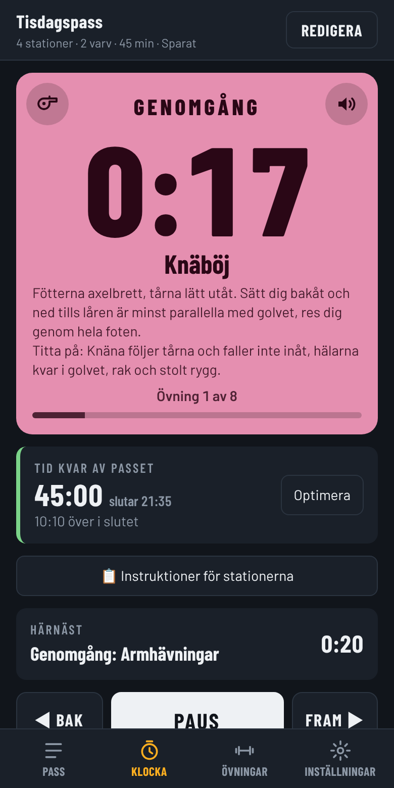
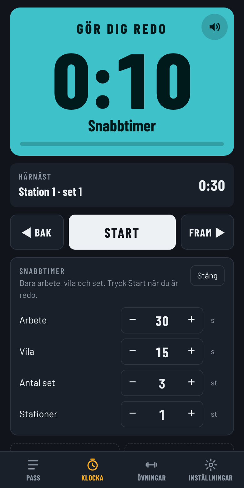

# WorkoutTimer

Intervallklocka för pass med stationer: cirkelträning, CrossCage och egen träning. Den är en webbapp som läggs på telefonens hemskärm och fungerar utan internet.

**Öppna appen: <https://petermcj.github.io/workouttimer/>**

  
  
  
  

## Det här gör den

- **Bygg pass** med stationer, övningar, set och varv. Appen räknar ut arbete och vila så att allt ryms i passets tid.
- **Klockan** visar fas, övning, nästa moment och tid kvar av passet, med ljudsignaler och röst. Optimera anpassar resten av passet om ni ligger efter.
- **Instruktör eller egen träning.** Instruktören får genomgång av övningar och kan visa instruktioner för alla stationer under passet.
- **Snabbtimer** med bara arbete, vila, set och stationer, utan att bygga ett pass.
- **Övningsbank** med 48 övningar och instruktioner, plus egna övningar och kommentarer.
- **Spotify** (Premium): spellista vid start, spela/pausa och nästa låt. Se [SPOTIFY.md](SPOTIFY.md).
- **Säkerhetskopia** till fil, och svenska eller engelska.

## Installera på telefonen

- **iPhone:** öppna länken i Safari, tryck på Dela och välj *Lägg till på hemskärmen*.
- **Android:** öppna länken i Chrome och tryck *Installera appen*.

## Utveckling

Appen är `index.html`, `app.js` och `sw.js`, utan bibliotek. Kör testerna med `npm install` och `npm test`. Hur du publicerar en ny version, och vad som gäller för säkerhet och beroenden, står i [docs/UTVECKLING.md](docs/UTVECKLING.md).
